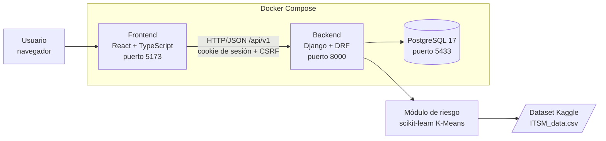
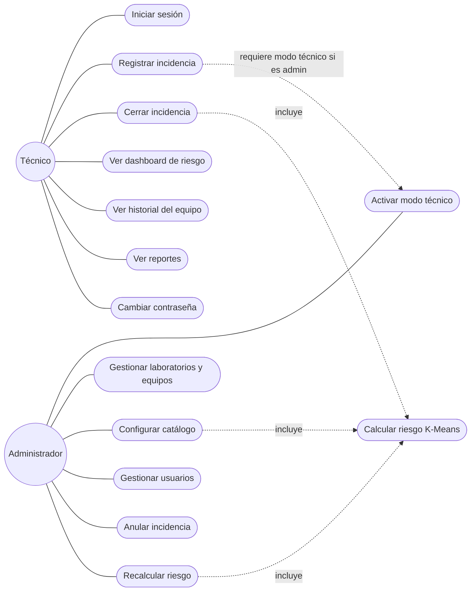
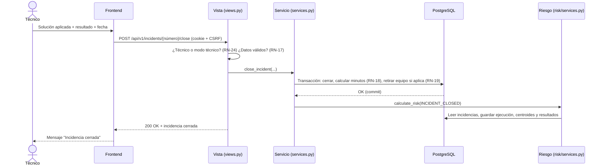
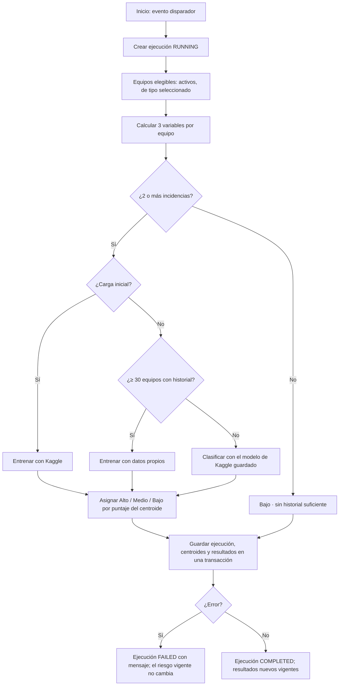
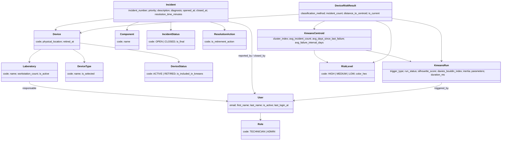

# NexoLab — Lo construido, para redactar la tesis

> **Para quién es:** para quien redacta el estudio de caso (capítulos 1 a 8 de la plantilla UNEMI).
> **Qué contiene:** lo que el sistema hace de verdad, con los números que salen de la base de datos y del código, y
> las partes en que el borrador del capítulo 3 no coincide con lo construido.
> **Fecha de corte:** 16/11/2026 (incluye los cambios de la revisión, modo técnico y "Solución aplicada", y las mejoras de calidad: límite de intentos de login, sesión vencida y respaldos). Repositorio: `github.com/SnayderC/NexoLab`.
> **Regla:** si la tesis y el sistema dicen cosas distintas, el tribunal lo va a notar. Cada diferencia de la
> sección 1 se resuelve de una de dos formas: se ajusta el texto de la tesis o se cambia el sistema. No se dejan las dos
> versiones.

---

## Índice

1. [Diferencias entre el borrador de la tesis y el sistema](#1-diferencias-entre-el-borrador-de-la-tesis-y-el-sistema) (con textos de reemplazo para Celery y Redis en 1.1)
2. [Resumen del sistema (para Resumen y Abstract)](#2-resumen-del-sistema)
3. [Estado de cada requisito (capítulo 3.2)](#3-estado-de-cada-requisito)
4. [Cómo se desarrolló en la práctica (capítulos 3.4 y 3.5)](#4-cómo-se-desarrolló-en-la-práctica)
5. [Diseño (capítulo 4)](#5-diseño-capítulo-4)
6. [Desarrollo (capítulo 5.1 a 5.4)](#6-desarrollo-capítulo-51-a-54)
7. [Pruebas y resultados (capítulo 5.5)](#7-pruebas-y-resultados-capítulo-55)
8. [Datos de demostración: de dónde salen](#8-datos-de-demostración)
9. [Resultados del modelo K-Means](#9-resultados-del-modelo-k-means)
10. [Material para conclusiones y recomendaciones (capítulo 6)](#10-material-para-conclusiones-y-recomendaciones)
11. [Anexo D: secciones de código recomendadas](#11-anexo-d-secciones-de-código-recomendadas)

---

## 1. Diferencias entre el borrador de la tesis y el sistema

Revisado contra el PDF "Grupo F - CAPITULO 3". Están ordenadas de mayor a menor impacto.

| # | Tema | Lo que dice la tesis | Lo que hace el sistema | Dónde aparece en la tesis | Propuesta |
|---|---|---|---|---|---|
| 1 | **Procesamiento en segundo plano** | Celery y Redis; recálculo automático **cada 15 minutos** | **No hay Celery, Redis ni recálculo periódico.** K-Means se ejecuta dentro de Django justo después de guardar el cierre de una incidencia, al anularla, al guardar el catálogo o con el botón "Recalcular ahora". Tarda entre 50 y 120 ms, así que el usuario no nota espera (decisión D-06) | Objetivo específico 3, 1.2, RF11 (CA01–CA03), RNF07, HU08 (CA05), Tabla 33 semana 6, Tabla 34 semana 6, CP22–CP25 | **Ajustar la tesis** (recomendado): cambiar a "recálculo por eventos", justificando que con este volumen el cálculo dura milisegundos y dos servicios menos simplifican la instalación. Dejar Celery como recomendación futura. Si el tutor exige Celery, hay que programarlo (varios días). **Textos listos para reemplazar: sección 1.1** |
| 2 | **Autenticación** | JWT y "tokens con tiempo de expiración" | **Sesión de Django** con cookie `sessionid` HttpOnly que dura 8 horas, más protección CSRF (D-25). No hay tokens JWT | RF01 (observaciones), RNF01 (métrica y verificación), CP03 ("token inválido") | **Ajustar la tesis:** "autenticación por sesión con cookie HttpOnly y CSRF; la sesión expira a las 8 horas". Es más segura para una web (JavaScript no puede leer la cookie) |
| 3 | **Laboratorios y equipos** | 5 laboratorios (H101–H105) y 142 equipos | **El sistema no tiene límite.** Los datos de demostración tienen 10 laboratorios (H101–H109, con H106A y H106B) y 432 equipos, descritos por el autor. El 142 venía del prototipo de Figma | Objetivo general y específicos, 1.2 (alcance), RF03, RF04, Tabla 33 semana 2, RNF03, CP31, integración de antecedentes | Decidir con el tutor: (a) cambiar la tesis a "10 laboratorios del Bloque H" o (b) reducir los datos de demostración a H101–H105. El sistema funciona igual en ambos casos |
| 4 | **Registros históricos** | "636 registros previos de soporte TI" | Se usa el dataset **ITSM de Kaggle** (`backend/data/ITSM_data.csv`): 46 606 registros. Filtrando solo incidencias de equipos parecidos a los de un laboratorio quedan **2 519 incidencias de 1 219 equipos**; **142 equipos** tienen 2 o más y son los que entrenan el modelo | 1.2, alcance, TK02 | **Ajustar la tesis** con estas cifras. El número 636 no sale de ningún filtro del dataset; si viene de otra fuente, hay que indicarla |
| 5 | **Estado "Remitida"** | La incidencia queda "Remitida", distinta del cierre | Las incidencias solo tienen dos estados: **Abierta y Cerrada**. "Derivado" es una **acción de cierre**: la incidencia se cierra y, si el equipo vuelve a fallar, se registra una nueva (RN-20, D-08) | RF08 CA05, HU07 CA06, CP15 | **Ajustar la tesis:** "al cerrar se registra la solución aplicada y se elige el resultado de la atención: Resuelto, Requiere reemplazo o Derivado (atención especializada)" |
| 6 | **Equipos sin historial suficiente** | No se les asigna un nivel de riesgo | Los equipos con menos de 2 incidencias **sí** aparecen como riesgo bajo, pero marcados con el método `INSUFFICIENT_HISTORY` y sin grupo de K-Means (RN-23). En la interfaz se distinguen con la etiqueta "Sin historial suficiente" | RF10 CA05, HU08 CA06, CP21 | **Ajustar la tesis:** "se identifican como 'sin historial suficiente' y no entran al algoritmo". Así se describe exactamente lo que se hace |
| 7 | **Monitores, teclados y mouse** | Son equipos del inventario | Son **componentes de la PC**, no equipos aparte (D-02). Si un monitor se daña, se registra la incidencia en la PC con el componente "Monitor". Los componentes son: PC, Monitor, Teclado, Mouse, UPS, Software, Red/Internet y Otro | 1.2 (alcance), objetivo 1 | **Ajustar la tesis:** "el inventario registra computadoras, todo en uno, UPS, televisores, aires acondicionados y PC docente; teclados, mouse y monitores se registran como componente afectado" |
| 8 | **Recálculo al registrar un equipo nuevo** | Un equipo nuevo dispara el recálculo | No lo dispara: un equipo nuevo **entra en riesgo bajo** hasta el siguiente cálculo, porque no tiene historial (D-36) | RF11 CA03, CP24 | Ajustar el texto: el recálculo se dispara al cerrar, anular, cambiar el catálogo o a pedido del administrador |
| 9 | **Eliminar equipos** | "Las operaciones de eliminación deberán respetar los antecedentes" | **No se eliminan equipos**: se retiran. El retiro conserva todo el historial. Falta decidir si se agrega "anular equipo creado por error" | RF04 observaciones | Cambiar "eliminación" por "retiro" |
| 10 | **Número de grupos (k)** | Comprobar si k=3 es adecuado (método del codo, referente de Vita et al.) | **k = 3 fijo.** No se programó el método del codo; la calidad se mide con silueta y Davies-Bouldin en cada ejecución | 2 (referentes), RF10 | Mencionar k=3 como decisión de diseño (tres niveles de riesgo) y el codo como trabajo futuro, o hacer un análisis del codo aparte para el capítulo de resultados |
| 11 | **Rendimiento (RNF03) y usabilidad (RNF06)** | Metas: 95 % de respuestas en ≤ 3 s con 10 usuarios; 4 de 5 participantes completan 3 tareas | **RNF03 medido el 16/11/2026: cumple** (sección 7.3). **RNF06 todavía no se aplica:** la ficha está lista en `docs/evidencias/ficha_usabilidad.md` | RNF03, RNF06, CP31, CP33 | RNF03: cambiar "142 equipos" por los 432 con que se midió (sección 7.3). RNF06: aplicar la ficha a 5 personas y anotar el resultado |
| 12 | **Funciones agregadas** | No están en el capítulo 3 | **Anular incidencia** (RN-22, solo administrador) y **pantalla de Reportes** (D-40) | — | Agregarlas: Reportes cubre RU08 y Anular cubre la integridad del historial. Ver sección 3 |
| 13 | **Tablero Kanban y fechas** | 8 semanas, tablero con evidencia semanal | En el repositorio no hay tablero; la evidencia disponible es el **historial de Git** (sección 4) | 3.4, 3.5, Tabla 34 | Llenar la Tabla 34 con fechas reales y capturas del tablero si existe |
| 14 | **Pantallas pequeñas** | RNF06 no habla de dispositivos | La interfaz está hecha para escritorio (1440 px, como el Figma). En tablet y celular no se adapta bien | — | Si se menciona, decir "diseñada para escritorio" y dejar el diseño adaptable como recomendación |
| 15 | **"Diagnóstico" al cerrar** (cambio de la revisión) | RF08 y HU07: "registrar el diagnóstico y la acción realizada" | Al cerrar se piden **"Solución aplicada"** (qué se hizo) y **"Resultado de la atención"** (Resuelto, Requiere reemplazo o Derivado). El diagnóstico es una etapa anterior; los nombres siguen a ITIL (D-44) | RF08 (nombre, descripción, CA01, CA04), HU07, CP14, Tabla 31 | **Ajustar la tesis:** RF08 "Registro de la solución y cierre de incidencias" |
| 16 | **Administrador y técnico** (cambio de la revisión) | RF06, RF07 y RF08: el actor es "técnico de soporte y administrador/coordinador" | El administrador **no registra ni cierra** en su modo normal. Para hacerlo activa el **modo técnico**, y el servidor lo controla (RN-24, D-45). En su modo normal consulta, anula, recalcula y administra | RF01 (CA03), RF06, RF08, RNF01, HU01, CP03 | **Ajustar la tesis:** actor de RF06 y RF08 = "técnico de soporte (o administrador en modo técnico)"; agregar a RF01 "CA04: el administrador cambia entre su modo y el modo técnico" |


### 1.1 Textos de reemplazo: Celery, Redis y "cada 15 minutos"

El sistema **no usa Celery ni Redis** y **no recalcula cada 15 minutos**. El riesgo se recalcula **por eventos**:
al cerrar una incidencia, al anularla, al guardar el catálogo y cuando el administrador pulsa "Recalcular ahora".
Cada cálculo tarda entre 50 y 120 ms con 432 equipos, queda guardado con sus métricas y, si falla, no deshace la
operación que lo disparó. Estos son los textos para reemplazar en el capítulo 3; la justificación va en el último
punto.

**Objetivo específico 3** (en 1.2). En lugar de "Integrar el procesamiento periódico mediante Celery y Redis y
organizar el entorno local con Docker Compose", escribir:
> Integrar la actualización automática de los agrupamientos ante los eventos que modifican el historial (cierre y
> anulación de incidencias, cambios en el catálogo) y organizar el entorno local con Docker Compose.

**Propósito del caso** (1.2). En lugar de "mantenga separado, en segundo plano, el procesamiento necesario para
agrupar los equipos", escribir:
> …y actualice el agrupamiento de los equipos cada vez que cambie su historial, sin interrumpir el registro de las
> atenciones.

**RF11 (Tabla 11).**
- *Descripción:* "El sistema debe actualizar automáticamente los agrupamientos de riesgo mediante K-Means cuando se
  produzcan cambios relevantes: el cierre o la anulación de una incidencia y la modificación del catálogo de equipos.
  El administrador también puede solicitar un recálculo manual."
- *CA01:* "recalcular al cerrar una incidencia, después de guardar el cierre". *CA02:* "recalcular al anular una
  incidencia". *CA03:* "recalcular al guardar el catálogo de tipos de equipo". *CA04 a CA06:* se mantienen.
- *Observaciones:* "El cálculo se ejecuta dentro del backend una vez confirmado el cambio que lo dispara. Si falla,
  el cambio se conserva y la ejecución queda registrada como fallida con su mensaje de error. Un equipo nuevo entra
  con riesgo bajo hasta el siguiente cálculo."

**RNF07 (Tabla 20).** Cambiar el nombre a **"Independencia del procesamiento"**:
- *Descripción:* "El recálculo de los agrupamientos no debe impedir ni deshacer las operaciones de registro, cierre
  y anulación de incidencias."
- *Métrica:* "En el 100 % de los casos de prueba, un error del cálculo de K-Means no deshace el cierre de la
  incidencia y queda registrado como ejecución fallida. Cada cálculo tarda menos de 1 segundo con los equipos del
  Bloque H."
- *Evidencia:* "Registros de `hst_kmeans_runs` (estado, duración y mensaje de error) y pruebas automáticas."

**HU08 (Tabla 28), CA05:** "permitir la actualización automática de los agrupamientos cuando se cierre o anule
una incidencia y cuando se modifique el catálogo de equipos".

**Tabla 33, semana 6:** "integrar la actualización automática por eventos…" en lugar de "integrar el
procesamiento en segundo plano". Entregable: "…con actualización automática ante los eventos definidos".

**Tabla 34, semana 6:** acción "Revisar los resultados del modelo y el recálculo por eventos" en lugar de "…el
funcionamiento de Celery".

**Tabla 35:**
- **CP22:** reemplazarlo por "Pulsar 'Recalcular ahora' como administrador → se crea una ejecución MANUAL con sus
  resultados" (prueba `test_administrador_recalcula`).
- **CP23:** "Cerrar una incidencia válida → se registra una ejecución INCIDENT_CLOSED" (prueba
  `test_cerrar_con_historial_suficiente_actualiza_el_riesgo`).
- **CP24:** quitar "o registrar un nuevo dispositivo".
- **CP25:** "Simular un error del cálculo al cerrar → el cierre se conserva y la ejecución queda FAILED" (prueba
  `test_cerrar_recalcula_el_riesgo_y_un_fallo_no_deshace_el_cierre`).

**Justificación** (para el capítulo 4 o 5, o si el tribunal pregunta):
> Se evaluó usar Celery y Redis para procesar el agrupamiento en segundo plano. Con el volumen del Bloque H
> (432 equipos), cada cálculo de K-Means tarda entre 50 y 120 milisegundos, de modo que ejecutarlo dentro del backend,
> después de confirmar el cambio que lo dispara, no genera esperas perceptibles. Esto evita dos servicios adicionales
> que habría que instalar, configurar y mantener. Un error del cálculo no afecta la operación del técnico: el cambio
> se conserva y la ejecución queda registrada como fallida. Si el volumen creciera, por ejemplo a varios bloques o
> sedes, se recomienda incorporar Celery y Redis para el procesamiento asíncrono y un recálculo programado.

**Recomendaciones (capítulo 6):** agregar "Incorporar Celery y Redis para el recálculo asíncrono y periódico si el
número de equipos crece".

---

## 2. Resumen del sistema

**Para el Resumen (máximo 150 palabras, en pasado), los datos que conviene incluir:**

- Se desarrolló una aplicación web **cliente-servidor**: React 19 con TypeScript en el frontend, y Django 5.2 con Django REST Framework y PostgreSQL 17 en el backend.
- **Registra incidencias** por laboratorio y equipo, calcula el tiempo de atención y retira el equipo cuando la acción de cierre es "Requiere reemplazo".
- **Clasifica los equipos** en riesgo alto, medio y bajo con **K-Means (k = 3)** de scikit-learn, usando tres variables: número de incidencias, días desde la última falla e intervalo promedio entre fallas.
- **Al inicio aprende de un dataset público de Kaggle:** 2 519 incidencias, con una silueta de 0,52. Cuando el laboratorio llega a 30 equipos con historial propio, aprende de sus datos; con los de demostración, la silueta fue de 0,39.
- **Se validó** con 97 pruebas automáticas y datos de demostración: 10 laboratorios, 432 equipos y 325 incidencias simuladas.

**Palabras clave sugeridas:** gestión de incidencias, K-Means, aprendizaje no supervisado, mantenimiento de equipos, aplicación web.
**Keywords:** incident management, K-Means, unsupervised learning, equipment maintenance, web application.

---

## 3. Estado de cada requisito

Significado de los estados:
- **Cumple:** el sistema hace lo que dice la ficha.
- **Cumple con cambio:** hace lo esencial, pero de forma distinta a como está escrita la ficha; hay que ajustar el texto según la sección 1.
- **Pendiente:** no se ha hecho o no se ha medido.

### Requisitos funcionales

| RF | Nombre | Estado | Cómo se cumple (pantalla / código) |
|---|---|---|---|
| RF01 | Autenticación | Cumple con cambio (sesión, no JWT) | `/login`. El mensaje de error es el mismo exista o no el correo (RN-01); un usuario desactivado no entra (RN-02); el menú cambia según el rol. Código: `backend/apps/users/views.py` |
| RF02 | Administración de usuarios | Cumple | `/admin/usuarios`: crear con contraseña temporal, editar, activar o desactivar y restablecer la contraseña. Nadie puede desactivarse a sí mismo (RN-05) |
| RF03 | Gestión de laboratorios | Cumple | `/admin/laboratorios`: código único, responsable opcional y composición de equipos. No se desactiva un laboratorio con incidencias abiertas (RN-10) |
| RF04 | Gestión de equipos | Cumple | `/admin/equipos`: código único con formato `LAB-TIPO-NN` (RN-11), filtros, edición y retiro (RN-12). El retiro conserva el historial |
| RF05 | Catálogo de equipos | Cumple | `/admin/catalogo`: 34 tipos; se eligen los que usa la institución. Al guardar, se recalcula el riesgo (RN-07, RN-08) |
| RF06 | Registro de incidencias | Cumple con cambio (actor: técnico o administrador en modo técnico, RN-24) | `/incidencias/nueva`: laboratorio, equipo del laboratorio, componente, prioridad y descripción. El número `INC-AAAA-NNNN` lo genera el sistema, y quien registra sale de la sesión (RN-14, RN-15) |
| RF07 | Consulta y seguimiento | Cumple | `/incidencias` (lista con filtros) y `/equipos/:código` (historial completo del equipo, con su riesgo y evolución) |
| RF08 | Solución y cierre | Cumple con cambio ("Remitida" es el resultado "Derivado"; "Diagnóstico" ahora es "Solución aplicada"; actor técnico o modo técnico) | Modal "Cerrar incidencia": solución aplicada, resultado de la atención, observaciones y fecha de cierre (RN-17, D-44). Una cerrada no se modifica (RN-21) |
| RF09 | Estados y tiempos | Cumple | El tiempo de atención se calcula solo (RN-18). Con "Requiere reemplazo", el equipo se retira **en la misma transacción** (RN-19); reemplazar un componente no retira el equipo |
| RF10 | Agrupamiento K-Means | Cumple con cambio (sin historial = bajo identificado) | `backend/apps/risk/`: 3 variables, `StandardScaler`, `KMeans(k=3, semilla 42)`, niveles por puntaje de centroides y resultados guardados |
| RF11 | Actualización de agrupamientos | Cumple con cambio (por eventos; sin Celery ni cada 15 min) | Se recalcula al cerrar o anular una incidencia, al cambiar el catálogo y con el botón "Recalcular ahora" |
| RF12 | Panel de indicadores y riesgos | Cumple | Dashboard `/`: incidencias abiertas, tiempo promedio, conteo por nivel, tres columnas de riesgo con color y texto, y filtros por laboratorio y tipo |
| *Nuevo* | Modo técnico del administrador | Agregado (revisión del 12/11/2026) | Menú de usuario → "Activar modo técnico". El servidor rechaza con 403 que el administrador registre o cierre sin el modo (RN-24, D-45) |
| RF13 | Perfil y contraseña | Cumple | `/perfil`: pide la contraseña actual y valida la nueva con las reglas de Django (RN-04). No permite cambiar el rol |
| *Nuevo* | Anular incidencia | Agregado | Solo el administrador. La incidencia no se borra, pero deja de contar para el riesgo y los indicadores (RN-22) |
| *Nuevo* | Reportes por periodo | Agregado (cubre RU08) | `/reportes`: registradas y cerradas, tiempo promedio, equipos retirados, fallas por laboratorio, componente y prioridad, atención por técnico y los 10 equipos con más fallas |

### Requisitos no funcionales

| RNF | Atributo | Estado | Evidencia disponible |
|---|---|---|---|
| RNF01 | Seguridad | Cumple con cambio (sesión, no tokens) | Pruebas de login, CSRF, accesos sin sesión (401) y técnico en administración (403). Límite de 5 intentos de login fallidos con bloqueo de 15 minutos (RN-25). Al vencer la sesión (8 h), el sistema lleva al login con un aviso (D-47); esto cubre "controlar la validez de las sesiones". Contraseñas con hash y credenciales en `.env` |
| RNF02 | Integridad | Cumple | Cierre y retiro en una transacción (`transaction.atomic`); claves foráneas `PROTECT` (no se borra nada con historial); prueba "un fallo del modelo no deshace el cierre". Respaldos con `scripts/respaldar.sh` y restauración todo o nada con `scripts/restaurar.sh` (D-48) |
| RNF03 | Rendimiento | **Cumple** (medido el 16/11/2026) | Con 10 usuarios a la vez, el **100 %** de 1 800 solicitudes respondió en ≤ 3 s (percentil 95: 0,43 s; máximo: 0,94 s), sin errores. Con 30 usuarios, también el 100 % (percentil 95: 1,2 s). Script `scripts/medir_rendimiento.py`; informes en `docs/evidencias/` |
| RNF04 | Trazabilidad | Cumple | Cada ejecución guarda la fecha, el disparador, el usuario, la semilla, las métricas, los centroides, el resultado por equipo y el origen de los datos (con el hash SHA-256 del dataset) |
| RNF05 | Entorno reproducible | Cumple | `docker compose --profile app up -d` levanta base de datos, backend y frontend |
| RNF06 | Usabilidad | Pendiente de aplicar | El diseño sigue el prototipo de Figma aprobado. Protocolo listo: 3 tareas y cuestionario SUS en `docs/evidencias/ficha_usabilidad.md` |
| RNF07 | Procesamiento asíncrono | Cumple con cambio | El cálculo corre después de guardar. Si falla, el cierre no se deshace y la ejecución queda `FAILED` con su mensaje de error. No es asíncrono en sentido estricto (sin Celery) |

---

## 4. Cómo se desarrolló en la práctica

**Orden real:**
1. Primero la interfaz con datos de demostración, siguiendo el Figma.
2. Después el backend.
3. Al final, la conexión entre los dos (D-11).

Historial de Git (fechas reales, útiles para llenar la Tabla 34):

| Fecha | Qué se hizo |
|---|---|
| 24/10/2026 | Estructura del frontend, sistema de diseño (colores y componentes del Figma), login, dashboard e incidencias con datos de demostración |
| 26/10/2026 | Historial del equipo, administración de laboratorios y equipos, pantalla de acceso restringido |
| 29/10/2026 | Catálogo, usuarios y perfil. **Backend Django completo:** modelos de la BD v4, autenticación por sesión, API de laboratorios, usuarios, equipos, incidencias y catálogo, y modelo K-Means real con Kaggle. Se eliminaron los datos de demostración del frontend. Se agregaron "Anular incidencia" y el mínimo configurable de 30 equipos |
| 05/11/2026 | Pantalla de Reportes, datos de demostración del Bloque H con historial simulado, Docker Compose, guía del proyecto y guion de la demostración |

Para ver el detalle: `git log --reverse --date=short --format="%ad %s"`.

**Decisiones de diseño:** las 43 decisiones (D-01 a D-43), con su motivo, están en la sección 17 de [CONTEXTO_DESARROLLO.md](CONTEXTO_DESARROLLO.md). Sirven para la columna "Bloqueo o cambio" de la Tabla 34 y para justificar cambios ante el tribunal.

---

## 5. Diseño (capítulo 4)

### 5.1 Arquitectura del software (4.1)

**Tipo:** arquitectura **cliente-servidor** con una **API REST**. El backend está organizado **en capas**: vista → serializador → servicio → modelo.



**Componentes:**

| Componente | Responsabilidad |
|---|---|
| Frontend (`frontend/`) | Pantallas, formularios y validación previa. **No tiene lógica de negocio** |
| Backend (`backend/`) | Sesión y permisos, reglas de negocio (RN-01 a RN-25), API REST y modelo K-Means |
| Base de datos | 14 tablas. Nada se borra: la eliminación es lógica (`is_active`) |
| Módulo de riesgo (`apps/risk`) | Calcula variables, entrena o clasifica, asigna niveles y guarda la ejecución |

**Capas del backend:**
- **URL** (`urls.py`).
- **Vista** (`views.py`): recibe la petición y revisa los permisos.
- **Serializador** (`serializers.py`): valida los datos de entrada.
- **Servicio** (`services.py`): aplica las reglas de negocio y abre las transacciones.
- **Modelo** (`models.py`): define la tabla.

**Por qué esta arquitectura:**
- Separa la interfaz de las reglas: todas las validaciones se repiten en el servidor, así que saltarse la pantalla no sirve para romperlas.
- La API permitiría agregar otro cliente, como una app móvil, sin tocar el backend.
- Python es el lenguaje natural para scikit-learn, y por eso el modelo vive en el mismo backend.
- Para el volumen de un bloque de laboratorios basta con un solo servidor: no se necesitan microservicios.

### 5.2 Diseño dinámico y estático (4.2)

**Casos de uso:**

| Actor | Casos de uso |
|---|---|
| Técnico | Iniciar sesión · Ver dashboard · Registrar incidencia · Consultar incidencias · Cerrar incidencia · Ver historial del equipo · Ver reportes · Cambiar contraseña |
| Administrador | Iniciar sesión · Ver dashboard · Consultar incidencias · Ver historial · Ver reportes · Cambiar contraseña · Recalcular riesgo · Anular incidencia · Gestionar laboratorios, equipos, catálogo y usuarios · **Activar modo técnico** |
| Administrador en modo técnico | Lo mismo que el técnico (registrar y cerrar incidencias); no ve la administración |
| Sistema | Recalcular el riesgo al cerrar o anular una incidencia y al cambiar el catálogo |



**Secuencia: cerrar una incidencia** (es el flujo más completo):



**Actividad: cálculo de riesgo** (`calculate_risk`):



**Diagrama de clases** (modelos de Django; cada clase es una tabla):



Los nombres exactos de los campos están en `backend/apps/*/models.py` y en el DBML.

**Cómo pasar los diagramas a la tesis:** los bloques `mermaid` se ven como diagrama en GitHub y en mermaid.live, desde donde se exportan como imagen. El diagrama entidad-relación se obtiene pegando `docs/NEXOLAB_BD_v4.dbml` en dbdiagram.io.

### 5.3 Diseño de base de datos (4.3)

- **Fuente:** [NEXOLAB_BD_v4.dbml](NEXOLAB_BD_v4.dbml), aprobado por la docente.
- **Tamaño:** 14 tablas y 19 relaciones.
- **Implementación:** PostgreSQL 17, con migraciones de Django.

**Convenciones:**
- Nombres en inglés, en `snake_case`, con prefijo por tipo de tabla: `cat_` catálogo, `mst_` maestra, `trx_` transaccional y `hst_` histórica.
- Todas las tablas tienen `is_active`, `created_at` y `updated_at`.

| Grupo | Tablas | Qué guarda |
|---|---|---|
| Usuarios | `cat_roles`, `mst_users` | Roles (Técnico, Administrador) y usuarios. El login es por correo y la contraseña se guarda con hash |
| Infraestructura | `mst_laboratories`, `cat_device_types`, `cat_device_statuses`, `mst_devices` | Laboratorios; 34 tipos de equipo con `is_selected`; estados Activo y Retirado; equipos con su código, ubicación y fecha de retiro |
| Incidencias | `trx_incidents`, `cat_components`, `cat_incident_statuses`, `cat_resolution_actions` | La incidencia, el componente afectado, el estado (Abierta o Cerrada) y la acción de cierre (Resuelto, Requiere reemplazo o Derivado; esta última con `is_retirement_action`) |
| Riesgo | `cat_risk_levels`, `hst_kmeans_runs`, `hst_kmeans_centroids`, `hst_device_risk_results` | Niveles con su color; cada ejecución del modelo con sus métricas; el perfil de cada grupo; el nivel de cada equipo en cada ejecución (`is_current` marca el vigente) |

**Puntos que vale la pena explicar en la tesis:**
- **Estado de registro y estado de negocio son cosas distintas.** `is_active = false` significa que el registro se anuló. Un equipo **retirado** sigue siendo un registro activo y conserva su historial.
- **Una incidencia tiene dos fechas.** `opened_at` es cuándo ocurrió la falla y `created_at` es cuándo se registró.
- **Las tablas `hst_` nunca se sobrescriben.** Cada cálculo agrega filas nuevas, y eso es lo que permite el gráfico de evolución del riesgo y la auditoría (RNF04).

---

## 6. Desarrollo (capítulo 5.1 a 5.4)

### 6.1 Tecnologías y herramientas (5.1)

| Capa | Tecnología | Versión | Por qué |
|---|---|---|---|
| Frontend | React | 19 | Componentes reutilizables; es el estándar de la industria |
| Frontend | TypeScript | 6 | Detecta errores de tipos antes de ejecutar |
| Frontend | Vite | 8 | Servidor de desarrollo rápido y compilación |
| Frontend | Tailwind CSS | 4 | Estilos con los colores del Figma definidos una sola vez (tokens) |
| Frontend | React Router | 8 | Navegación entre pantallas |
| Frontend | TanStack Query | 5 | Pedir datos a la API con caché y estados de carga |
| Frontend | React Hook Form + Zod | 7 / 4 | Formularios y validaciones |
| Frontend | lucide-react | 1.x | Íconos (los mismos del Figma) |
| Backend | Python | 3.14 (compatible con 3.12+) | Lenguaje del backend y del modelo |
| Backend | Django | 5.2 LTS (5.2.19) | Framework web con soporte extendido; incluye sesiones, ORM y migraciones |
| Backend | Django REST Framework | 3.18 | API REST, serializadores y permisos |
| Backend | scikit-learn | 1.8 | `KMeans`, `StandardScaler`, silueta y Davies-Bouldin |
| Backend | NumPy | 2.5 | Cálculos numéricos |
| Backend | psycopg | 3.3 | Conector de PostgreSQL |
| Backend | django-environ | 0.14 | Leer credenciales desde `.env` |
| Datos | PostgreSQL | 17 | Base de datos relacional con transacciones |
| Entorno | Docker y Docker Compose | — | Levantar todo con un comando |
| Herramientas | VS Code, Git y GitHub, Figma, ESLint | — | Edición, control de versiones, diseño y revisión de código |

### 6.2 Front end (5.2)

**Estructura:**
- `frontend/src/features/<módulo>/`, con una carpeta por módulo: auth, dashboard, incidents, devices, laboratories, catalog, users, profile y reports.
- Cada módulo tiene `pages/` (pantallas), `components/` (piezas propias) y `api.ts` (llamadas a la API).
- Además están `components/ui/` (botones, tablas, modales, etc.), `components/layout/` (menú lateral y protección de rutas) y `lib/apiClient.ts` (el cliente HTTP).

**Pantallas para capturar** (inicia sesión como Andrea para ver todo):

| Pantalla | Ruta | Qué explicar |
|---|---|---|
| Inicio de sesión | `/login` | Mensaje de error genérico y bloqueo de usuario desactivado |
| Dashboard | `/` | Indicadores, incidencias abiertas, columnas de riesgo Alto, Medio y Bajo, filtros y "Recalcular ahora" |
| Registrar incidencia | `/incidencias/nueva` | Formulario, y el panel del equipo con su riesgo y sus últimas fallas |
| Incidencias | `/incidencias` | Lista con filtros, y los modales de cierre y de anulación |
| Historial del equipo | `/equipos/H107-PC-08` | Riesgo actual, gráfico de evolución mes a mes e incidencias |
| Reportes | `/reportes` | Indicadores del periodo, barras por laboratorio y componente, técnicos y top 10 de equipos |
| Laboratorios, Equipos, Catálogo, Usuarios | `/admin/...` | Gestión; el técnico ve "Acceso restringido" |
| Mi perfil | `/perfil` | Cambio de contraseña |

**Fragmentos de código recomendados:** ver la sección 11.

### 6.3 Back end (5.3)

**Módulos** (`backend/apps/`):

| App | Contenido |
|---|---|
| `users` | Login, logout, usuario actual, cambio de contraseña, gestión de usuarios y permisos por rol |
| `infrastructure` | Laboratorios, tipos de equipo (catálogo) y equipos |
| `incidents` | Incidencias (registrar, listar, cerrar, anular) y reportes |
| `risk` | Modelo K-Means, dashboard y recálculo |
| `core` | Modelo base común y comando `seed_demo` (datos de demostración) |

**Servicios de la API** (base `/api/v1/`; 🔒 = solo administrador):

| Método y ruta | Uso |
|---|---|
| `GET auth/csrf` · `POST auth/login` · `POST auth/logout` · `GET auth/me` · `POST auth/change-password` | Sesión |
| `GET dashboard/summary` · `POST risk/recalculate` 🔒 | Dashboard y recálculo manual |
| `GET/POST incidents` · `GET incidents/{n}` · `POST incidents/{n}/close` · `POST incidents/{n}/void` 🔒 | Incidencias |
| `GET devices` · `GET devices/{código}` · `GET devices/{código}/incidents` · `POST devices` 🔒 · `PATCH devices/{id}` 🔒 | Equipos (el retiro se hace con PATCH) |
| `GET/POST laboratories` · `PATCH laboratories/{id}` · `POST .../activate` · `POST .../deactivate` 🔒 | Laboratorios |
| `GET device-types` · `POST device-types` 🔒 · `PUT device-types/selection` 🔒 · `GET catalogs` | Catálogo |
| `GET/POST users` 🔒 · `PATCH users/{id}` 🔒 · `POST users/{id}/reset-password` · `activate` · `deactivate` 🔒 | Usuarios |
| `GET reports/summary` | Reportes |

**Autenticación y sesión:**
1. El frontend pide `GET auth/csrf` y recibe la cookie `csrftoken`.
2. `POST auth/login` valida la contraseña y crea la sesión: la cookie `sessionid` es HttpOnly y dura 8 horas.
3. En cada petición, el navegador envía la cookie automáticamente; las peticiones que modifican datos llevan además la cabecera `X-CSRFToken`.
4. Sin sesión, la API responde 403.

**Errores:** códigos HTTP estándar (400, 403, 404, 409) con mensajes en español. Nunca se muestran trazas internas.

### 6.4 Integración del sistema (5.4)

**Entorno:** local, con Docker Compose (sin despliegue en la nube).

| Servicio | Contenedor | Puerto | Detalle |
|---|---|---|---|
| Base de datos | `nexolab_db` | 5433 (equipo) → 5432 | PostgreSQL 17; los datos se guardan en un volumen |
| Backend | `nexolab_backend` | 8000 | Aplica las migraciones al arrancar |
| Frontend | `nexolab_frontend` | 5173 | Vite reenvía `/api` al backend (proxy), así todo funciona en un solo origen y sin CORS |

**Configuración:**
- Las credenciales van en `.env` (raíz: base de datos) y `backend/.env` (`SECRET_KEY`, `DEMO_PASSWORD`).
- Los dos tienen plantillas `.env.example` y no se suben a GitHub.

**Comandos:**
```bash
docker compose --profile app up -d                          # levantar todo
docker compose exec backend python manage.py seed_demo --reset   # cargar datos de demostración
docker compose exec backend python manage.py test apps           # 97 pruebas
```

**Flujo general de uso:**
1. El técnico registra la falla.
2. La atiende y cierra la incidencia.
3. El sistema calcula el tiempo de atención y recalcula el riesgo.
4. El dashboard muestra qué equipos atender primero.
5. El administrador consulta los reportes del periodo.

---

## 7. Pruebas y resultados (capítulo 5.5)

### 7.1 Pruebas automáticas

**Resultado al 16/11/2026: 97 pruebas, todas correctas** (`Ran 97 tests ... OK`, 16,8 s). Son pruebas de integración del backend con Django y PostgreSQL: cada una llama a la API o al servicio real y revisa la respuesta y la base de datos.

| Módulo | Pruebas | Qué cubren |
|---|---|---|
| `users` | 28 | Login, límite de intentos (RN-25), CSRF, sesión (401), RN-01 a RN-06, cambio de contraseña, gestión de usuarios |
| `infrastructure` | 22 | Laboratorios (RN-10), equipos (RN-11, RN-12, D-21, D-43), historial y permisos |
| `incidents` | 26 | Registro (RN-13 a RN-16), cierre (RN-17 a RN-21), anulación (RN-22), modo técnico (RN-24), catálogo (RN-07 a RN-09) y reportes |
| `risk` | 21 | Variables, entrenamiento, semilla fija, niveles, RN-23, Kaggle, fallos del modelo, dashboard |

El frontend no tiene pruebas automáticas; se probó a mano en el navegador con los dos roles. Además se revisa con `npm run lint` y `npm run build`.

### 7.2 Casos de prueba de la Tabla 35, con la prueba automática que los respalda

Estados:
- **Cumple:** hay prueba automática y pasa.
- **Cumple con cambio:** pasa, pero el caso debe reescribirse según la sección 1.
- **No ejecutado:** falta hacerlo.

| CP | Resultado esperado (resumen) | Prueba automática | Estado |
|---|---|---|---|
| CP01 | Login válido muestra funciones del rol | `test_login_correcto_devuelve_usuario_con_rol` | Cumple |
| CP02 | Contraseña incorrecta rechazada | `test_rn01_mismo_mensaje_para_contrasena_incorrecta_y_correo_inexistente` | Cumple |
| CP03 | Sin permiso (403) o sin sesión (401): denegado | `test_rn06_tecnico_recibe_403_en_administracion`, `test_me_sin_sesion_es_rechazado`, `test_sin_sesion_responde_401` | Cumple con cambio (sesión, no token) |
| CP04 | Registrar usuario con rol | `test_crear_usuario_normaliza_correo_y_guarda_hash` | Cumple |
| CP05 | Cuenta desactivada no entra | `test_rn02_cuenta_desactivada_con_contrasena_correcta` | Cumple |
| CP06 | Código de laboratorio duplicado rechazado | `test_codigo_duplicado_sin_distinguir_mayusculas` | Cumple |
| CP07 | Equipo con código único en un laboratorio | `test_rn11_y_d21_codigo_valido_y_del_laboratorio_y_tipo` | Cumple |
| CP08 | Retiro conserva historial | `test_rn12_retirar_quita_el_riesgo_vigente_y_no_vuelve_a_activo`, `test_historial_de_equipo_retirado_y_codigo_inexistente` | Cumple |
| CP09 | Catálogo filtra formularios | `test_rn07_al_menos_un_tipo_y_rn08_recalcula`, `test_rn07_tipo_no_seleccionado_y_laboratorio_inactivo` | Cumple |
| CP10 | Equipos del laboratorio elegido | `test_equipos_elegibles_para_el_formulario` | Cumple |
| CP11 | Incidencia con número, fecha y estado | `test_registra_con_numero_correlativo_y_usuario_de_la_sesion` | Cumple |
| CP12 | Campos vacíos o inválidos rechazados | `test_rn16_descripcion_y_fecha`, `test_d24_otro_pide_20_caracteres` | Cumple |
| CP13 | Historial del equipo | `test_historial_con_riesgo_vigente_y_evolucion` | Cumple |
| CP14 | Cierre con solución aplicada y resultado | `test_cierra_calcula_el_tiempo_y_usa_el_usuario_de_la_sesion`, `test_rn17_validaciones_del_cierre` | Cumple |
| CP15 | "Remitida" | (acción "Derivado" cierra; RN-20) | Cumple con cambio |
| CP16 | Tiempo de atención calculado | `test_cierra_calcula_el_tiempo_y_usa_el_usuario_de_la_sesion` | Cumple |
| CP17 | Solo "Requiere reemplazo" retira | `test_rn19_requiere_reemplazo_retira_el_equipo` | Cumple |
| CP18 | Error no deja cambios parciales | `test_cerrar_recalcula_el_riesgo_y_un_fallo_no_deshace_el_cierre`, `test_sin_modelo_inicial_la_ejecucion_falla_y_no_cambia_el_riesgo` | Cumple |
| CP19 | Tres variables calculadas | `test_sin_incidencias`, `test_una_incidencia_no_tiene_intervalo`, `test_intervalo_promedio_entre_la_primera_y_la_ultima` | Cumple |
| CP20 | Tres grupos y centroides guardados | `test_entrena_y_asigna_niveles_por_perfil`, `test_misma_semilla_mismo_resultado`, `test_carga_inicial_con_kaggle_y_reuso_del_modelo` | Cumple |
| CP21 | Equipo sin historial identificado | `test_rn23_historial_insuficiente_es_bajo_sin_centroide` | Cumple con cambio |
| CP22 | Recálculo cada 15 min | — | No aplica (sin recálculo periódico) |
| CP23 | Recálculo al cerrar | `test_cerrar_con_historial_suficiente_actualiza_el_riesgo` | Cumple con cambio (sin tarea en segundo plano) |
| CP24 | Recálculo por catálogo o equipo nuevo | `test_rn07_al_menos_un_tipo_y_rn08_recalcula`, `test_crear_equipo_queda_en_riesgo_bajo` | Cumple con cambio |
| CP25 | El cierre no se bloquea por un error del modelo | `test_cerrar_recalcula_el_riesgo_y_un_fallo_no_deshace_el_cierre`, `test_error_de_calculo_responde_409` | Cumple con cambio |
| CP26 | Trazabilidad de ejecuciones | `test_solo_el_ultimo_resultado_es_vigente`, `test_carga_inicial_con_kaggle_y_reuso_del_modelo` | Cumple |
| CP27 | Dashboard con filtros y roles | `test_resumen_con_indicadores_grupos_e_incidencias_abiertas`, `test_filtros_cambian_grupos_pero_no_indicadores` | Cumple |
| CP28 | Perfil propio | `test_me_con_sesion` | Cumple |
| CP29 | Cambio de contraseña correcto | `test_cambio_correcto_mantiene_la_sesion_y_permite_entrar_con_la_nueva` | Cumple |
| CP30 | Contraseña actual incorrecta | `test_contrasena_actual_incorrecta` | Cumple |
| CP31 | Rendimiento ≤ 3 s, 95 % | `scripts/medir_rendimiento.py` (10 usuarios, 20 rondas, 9 consultas) | **Cumple:** 100 % en ≤ 3 s, 0 errores |
| CP32 | Docker Compose levanta todo | Verificado a mano: los 3 servicios "Up" y la API responde a través del frontend | Cumple |
| CP33 | Usabilidad 4 de 5 | Ficha `docs/evidencias/ficha_usabilidad.md` | Pendiente de aplicar |
| CP34 *(nuevo)* | Administrador sin modo técnico no registra ni cierra; con el modo sí, a su nombre; el modo se apaga al iniciar sesión; un técnico no puede activarlo | `test_rn24_sin_modo_tecnico_el_administrador_no_registra_ni_cierra`, `test_rn24_con_modo_tecnico_registra_y_cierra_a_su_nombre`, `test_rn24_el_modo_se_apaga_al_iniciar_sesion_de_nuevo`, `test_rn24_solo_el_administrador_cambia_de_modo` | Cumple |
| CP35 *(nuevo)* | 5 intentos fallidos bloquean el login 15 minutos, también con un correo inexistente; un login correcto reinicia el contador; otras cuentas no se afectan | `test_rn25_bloquea_tras_cinco_intentos_fallidos`, `test_rn25_correo_inexistente_se_bloquea_igual`, `test_rn25_un_login_correcto_reinicia_el_contador` | Cumple |
| CP36 *(nuevo)* | Respaldar y restaurar la base sin perder datos | Verificado a mano el 16/11/2026: 327 incidencias y 3 873 resultados de riesgo antes y después de restaurar | Cumple |

### 7.3 Rendimiento (RNF03, CP31): medido

**Cómo se midió:** el script `scripts/medir_rendimiento.py` simula varios usuarios que inician sesión a la vez y repiten
las 9 consultas más habituales: dashboard, lista de incidencias, historial y equipos, catálogos, laboratorios y reportes.
Las peticiones pasan por el frontend, como desde el navegador. Usa solo Python estándar y no modifica datos.

```bash
NEXOLAB_PASSWORD=... python3 scripts/medir_rendimiento.py --usuarios 10 --rondas 20 --salida informe.md
```

**Entorno:** computadora de desarrollo (Linux, 12 núcleos) con Docker Compose y el servidor de desarrollo de Django.
Datos de demostración: **432 equipos** y 327 incidencias, tres veces más equipos que los 142 que menciona la tesis.

| Escenario | Solicitudes | Mediana | Percentil 95 | Máximo | ≤ 3 s | Errores | Resultado |
|---|---|---|---|---|---|---|---|
| 10 usuarios a la vez (meta de RNF03) | 1 800 | 142 ms | 425 ms | 938 ms | 100 % | 0 | **Cumple** |
| 30 usuarios a la vez (margen) | 2 700 | 440 ms | 1 171 ms | 2 405 ms | 100 % | 0 | **Cumple** |

Las consultas más pesadas son el dashboard y los reportes de 6 meses (alrededor de 350 ms de mediana con 10 usuarios).
El detalle por consulta está en `docs/evidencias/rendimiento_10_usuarios.md` y `rendimiento_30_usuarios.md`.

**Texto sugerido para la tesis:** "Se simularon 10 usuarios concurrentes realizando 1 800 consultas habituales sobre
432 equipos. El 100 % respondió en menos de 3 segundos (percentil 95: 0,43 s), por lo que se cumple RNF03. Con 30
usuarios concurrentes el sistema mantuvo el 100 % de respuestas bajo el umbral (percentil 95: 1,2 s)."

### 7.4 Lo que falta ejecutar

- **CP33 (usabilidad, RNF06):** aplicar `docs/evidencias/ficha_usabilidad.md` a 5 personas. Trae las 3 tareas de la
  tesis con datos reales de la demostración, las reglas para el facilitador, el cuestionario SUS (con su cálculo y
  sus referencias) y la tabla de resumen. Se cumple si 4 de 5 completan las tres tareas sin ayuda.
- **Capturas:** tomar las de cada pantalla (sección 6.2) para las columnas "Resultado obtenido".
---

## 8. Datos de demostración

**Los datos que muestra el sistema no son reales del Bloque H.** Los creó el comando `python manage.py seed_demo` (D-42):
- El **inventario** sigue la descripción que dio el autor del Bloque H.
- Las **incidencias son simuladas**, generadas con una semilla fija para que la demostración sea siempre igual.

**Lo que sí es real:** los cálculos (tiempos, indicadores y riesgo) y el modelo K-Means.

**Inventario:**

| Laboratorios | Computadoras | Además, en cada laboratorio |
|---|---|---|
| H101, H102, H106A, H106B, H108, H109 | 30 PC de escritorio | 1 PC docente, 1 o 2 aires acondicionados, 1 o 2 televisores |
| H103, H104 | 30 PC gamer, cada una con su UPS | Igual |
| H105 | 30 todo en uno | Igual |
| H107 | 60 PC de escritorio | Igual |

- **Total: 10 laboratorios y 432 equipos.** Por tipo: 301 PC, 61 UPS, 30 todo en uno, 15 aires, 15 televisores y 10 PC docentes. De ellos, 429 están en uso y 3 retirados con "Requiere reemplazo".
- **Tipos seleccionados en el catálogo:** 6 de 34 (PC, todo en uno, UPS, televisor, aire acondicionado y PC docente).
- **Incidencias:** 325 entre mayo y octubre de 2026, de las cuales 8 quedan abiertas. Comportamiento simulado:
  - unas 15 computadoras fallan seguido;
  - los aires fallan más en los meses de calor;
  - los televisores y las PC docentes fallan poco.
- **Usuarios:**
  - Andrea Villacís, administradora;
  - Carlos Mendoza, técnico, que atiende la mayoría;
  - Luis Bravo, técnico desactivado desde agosto.
- **Historial del riesgo:**
  - una carga inicial con Kaggle el 01/05/2026;
  - un cálculo al cierre de cada mes, para que exista la evolución mensual;
  - un cálculo final.

Distribución de las incidencias (base de datos actual):

| Componente | Cantidad | | Prioridad | Cantidad | | Acción de cierre | Cantidad |
|---|---|---|---|---|---|---|---|
| PC | 124 | | Media | 151 | | Resuelto | 295 |
| Software | 74 | | Alta | 120 | | Derivado | 20 |
| Otro (aires, TV) | 38 | | Baja | 56 | | Requiere reemplazo | 3 |
| Monitor | 26 | | | | | Abiertas | 9 |
| Mouse | 23 | | | | | | |
| Teclado | 15 | | | | | | |
| UPS | 15 | | | | | | |
| Red/Internet | 12 | | | | | | |

*La base actual tiene 327 incidencias: las 325 de la demostración más 2 registradas en pruebas manuales. Con `seed_demo --reset` vuelve a 325.*

**Cómo decirlo en la tesis:** "Para validar el sistema se cargaron datos de demostración basados en la composición del Bloque H y un historial de incidencias simulado de seis meses. El cálculo del riesgo y los indicadores se ejecutó con el sistema real sobre esos datos."

---

## 9. Resultados del modelo K-Means

### 9.1 Dataset de Kaggle (carga inicial)

| Dato | Valor |
|---|---|
| Archivo | `ITSM_data.csv` (dataset ITSM de Kaggle, incidencias de TI de una empresa, 2012–2014) |
| Registros totales | 46 606 |
| Filtro | `Category = incident` y `CI_Subcat` ∈ {Desktop, Laptop, Thin Client, Monitor, Keyboard, UPS} (D-34) |
| Incidencias que quedan | 2 519, de 1 219 equipos |
| Equipos con ≥ 2 incidencias (entrenan) | **142** |
| Fecha de referencia para "días desde la última falla" | 31/03/2014 (última fecha del dataset) |
| Huella del archivo (SHA-256) | `2b5f28e9…6a` (guardada en la ejecución) |
| Silueta / Davies-Bouldin / Inercia | **0,522** / 0,745 / 164,9 |
| Iteraciones | 7 |

Centroides aprendidos de Kaggle (el perfil promedio de cada grupo):

| Nivel | Incidencias | Días desde la última falla | Cada cuántos días falla | Equipos del grupo |
|---|---|---|---|---|
| Alto | 47,1 | 7,9 | 6,8 | 25 |
| Medio | 2,3 | 126,3 | 15,7 | 98 |
| Bajo | 2,3 | 73,6 | 65,5 | 19 |

**Por qué se filtró así:** son los equipos más parecidos a los de un laboratorio. Las aplicaciones, los servidores y la red fallan de otra forma. Los días se miden desde la última fecha del dataset; medirlos desde hoy daría más de 10 años para todos.

### 9.2 Evolución con los datos de demostración

| Fecha del cálculo | Modelo usado | Silueta | Davies-Bouldin | Equipos Alto / Medio / Bajo (con K-Means) | Duración |
|---|---|---|---|---|---|
| 01/05/2026 | Entrena con Kaggle (carga inicial) | 0,522* | 0,745* | 0 / 0 / 0 (sin historial aún) | 498 ms |
| 01/06/2026 | Clasifica con Kaggle | — (un solo grupo con equipos) | — | 6 / 0 / 0 | 52 ms |
| 01/07/2026 | Clasifica con Kaggle | 0,420 | 0,533 | 10 / 2 / 4 | 53 ms |
| 01/08/2026 | **Entrena con datos propios** (30 equipos con historial) | 0,504 | 0,666 | 7 / 14 / 9 | 64 ms |
| 01/09/2026 | Datos propios | 0,441 | 0,773 | 7 / 30 / 9 | 69 ms |
| 01/10/2026 | Datos propios | 0,390 | 0,913 | 12 / 34 / 16 | 61 ms |
| 01/11/2026 | Datos propios | 0,392 | 0,916 | 14 / 34 / 24 | 59 ms |

\* Métricas del entrenamiento con Kaggle.

**Resultado final de la demostración:** 14 equipos en riesgo alto, 34 en medio y 381 en bajo. De los 381 de riesgo bajo, 24 fueron clasificados por K-Means y 357 no tienen historial suficiente (menos de 2 incidencias).

**Cómo interpretarlo:**
- **Calidad de los grupos.** La silueta de Kaggle (0,52) supera el 0,5 que reporta Roosadi et al. (2024). Con los datos propios queda entre 0,39 y 0,50: grupos razonablemente separados.
- **Por qué baja la silueta.** Los datos son simulados y, a medida que se acumula historial, los grupos se superponen más.
- **El cambio de modelo.** En agosto el sistema dejó de usar Kaggle porque se alcanzaron 30 equipos con historial propio: unos 10 por grupo, un mínimo práctico para que los grupos sean confiables. Ese mínimo es configurable (D-33).
- **Cómo se asigna el nivel.** Cada grupo recibe un puntaje: incidencias − días desde la última falla − intervalo promedio, con las variables estandarizadas. El de mayor puntaje es Alto (D-35). Así el nivel se justifica por el comportamiento del grupo y no por el número de grupo, como pide el referente de Vita et al.
- **Límite del modelo.** NexoLab **prioriza** equipos; **no predice** la fecha de la próxima falla.

---

## 10. Material para conclusiones y recomendaciones

**Cumplimiento de objetivos:**
- **Objetivo 1 (análisis y base de datos):**
  - se diseñó la base de datos v4 (14 tablas) en PostgreSQL;
  - se definieron 25 reglas de negocio (RN-01 a RN-25).
- **Objetivo 2 (módulos de gestión):**
  - registro, consulta, cierre y anulación de incidencias;
  - inventario y catálogo;
  - tiempo de atención automático y retiro de equipos;
  - todo con React, TypeScript y DRF.
- **Objetivo 3 (clustering y panel):**
  - K-Means con scikit-learn (k = 3), con datos escalados y la carga inicial con Kaggle;
  - dashboard de riesgo, historial y reportes;
  - Docker Compose.
  - **Diferencia:** el recálculo es por eventos y no usa Celery ni Redis (sección 1, punto 1).

**Lecciones y aportes:**
- **Arranque en frío.** Usar un dataset público resolvió el arranque sin historial; pasar a los datos propios a partir de un mínimo configurable permite usar el sistema en laboratorios de distintos tamaños.
- **Trazabilidad del modelo.** Guardar cada ejecución con sus métricas permite auditar por qué un equipo cambió de nivel.
- **Validación en el servidor.** Validar todo en el backend, no solo en la pantalla, protege las reglas aunque se use la API directamente.

**Recomendaciones (trabajo futuro):**
- Recálculo periódico con Celery y Redis si el volumen crece.
- Elegir k con el método del codo o la silueta.
- Un criterio de calidad (silueta) para decidir cuándo dejar el modelo de Kaggle.
- Diseño adaptable a tablet y celular.
- Exportar reportes a PDF o Excel.
- Notificaciones.
- Importación masiva por CSV.
- Integración con el inventario institucional.
- Despliegue en un servidor.
- Pruebas automáticas del frontend.
- Probar con datos reales del Bloque H.

---

## 11. Anexo D: secciones de código recomendadas

Son fragmentos cortos que se explican solos (cada archivo tiene comentarios en español).

| Tema | Archivo | Qué mostrar |
|---|---|---|
| Variables del modelo | `backend/apps/risk/kmeans.py` | `compute_features` |
| Entrenamiento | `backend/apps/risk/kmeans.py` | `train` (`StandardScaler` + `KMeans`) |
| Asignación de niveles | `backend/apps/risk/kmeans.py` | `assign_levels` |
| Kaggle | `backend/apps/risk/kaggle.py` | `load_training_rows` (filtro) |
| Proceso completo | `backend/apps/risk/services.py` | `calculate_risk` y `_build_model` (Kaggle o datos propios) |
| Cierre de incidencia | `backend/apps/incidents/services.py` | Cierre, tiempo, retiro y recálculo después de confirmar |
| Login | `backend/apps/users/views.py` | `LoginView` (RN-01, RN-02) |
| Permisos | `backend/apps/users/permissions.py` | Permiso de administrador |
| Reportes | `backend/apps/incidents/reports.py` | `ReportSummaryView` |
| Cliente HTTP | `frontend/src/lib/apiClient.ts` | Cookie de sesión y cabecera CSRF |
| Protección de rutas | `frontend/src/components/layout/RequireAdmin.tsx` | Pantalla "Acceso restringido" |
| Formulario | `frontend/src/features/incidents/components/IncidentForm.tsx` | Validación con Zod |
| Gráfico | `frontend/src/features/devices/components/RiskEvolutionChart.tsx` | Evolución del riesgo |

---

## Otros documentos del repositorio

- [GUIA_DEL_PROYECTO.md](GUIA_DEL_PROYECTO.md): explicación en español y glosario de los términos en inglés.
- [CONTEXTO_DESARROLLO.md](CONTEXTO_DESARROLLO.md): reglas de negocio completas, API y las 43 decisiones.
- [GUION_DEMOSTRACION.md](GUION_DEMOSTRACION.md): recorrido de la demostración y preguntas frecuentes.
- [NEXOLAB_BD_v4.dbml](NEXOLAB_BD_v4.dbml): modelo de datos.
